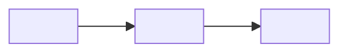

# Incident - <Short Name>

> **The guard**: one sentence. Name the class and the line that now prevents this failure.

## What the operator saw

The symptom, in the words of the operator or the client. Give the date and the site.

## What happened

The sequence of events, in order. Use a diagram if two or more tasks or threads take part.

## Why it happened

The root cause. Cite the line that made the failure possible, at the commit before the fix.

## The guard

What prevents the failure now. Cite the line at the current commit.

| Guard | Where | What it refuses |
| --- | --- | --- |
| <guard> | [[<Class>]] **L428-L434** | one sentence |

## Log markers

The log lines that show this failure. A reader searches the logs for these strings.

- `[PREFIX] <message>` -- written by `<Class>` **L123**.

## What is still open

What the guard does not cover. Write "Nothing" if the guard covers all of it.
